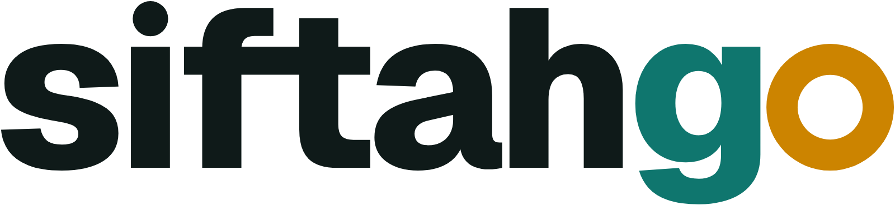

# SiftahGo — Logo kullanım kılavuzu

Sürüm 2.0 · 2026-10-22 · Sunum: [sunum/sunum.html](sunum/sunum.html) · Brief: [../brief.md](../brief.md)

## 1. Logo

**Fikir:** Logonun kendisi bir yazı: **siftahgo**. "go"nun o'su altın bir sikke halkası; anlamı "git, siftahı yap".
Eski logodaki küçük altın nokta burada sikkeye dönüştü.

**Yapı:**
- **Yazı tipi:** Sitedeki Geist'ın ExtraBold (800) kesimi, küçük harf, sıkı aralık (−0,04 em). Harfler konturlandı.
- **Özel dokunuşlar:** "o" tam daire bir halkaya çevrildi ve harf gövdesinin %80'i kalınlığında çizildi. i'nin noktası yuvarlak.
  f ile t'nin yatay çizgileri tek bar. g ile halka arasındaki aralık elle ayarlandı.
- **Renkler:** "siftah" mürekkep, "g" teal, halka altın.

| Sürüm | Dosya | Ne zaman |
|---|---|---|
| Yazı (ana logo) | `siftahgo-yazi-*.svg` | Site başlığı, e-posta, fiş, afiş; varsayılan budur |
| Küçük yazı | `siftahgo-yazi-kucuk-*.svg` | 72–120 px genişlik arası (daha ince ve açık aralıklı) |
| go işareti | `siftahgo-go-*.svg` | Yazının sığmadığı küçük alanlar, profil resmi |
| Uygulama ikonu | `siftahgo-uygulama-ikonu.svg` | Uygulama, favicon, kısayol |
| İkon + yazı | `siftahgo-ikon-yazi-*.svg` | Uygulama mağazası, e-posta imzası, "uygulamayı indir" alanları |

## 2. Renk sürümleri ve zeminler

| Dosya eki | Zemin | siftah | g | Halka |
|---|---|---|---|---|
| `renkli` | Beyaz ve açık zemin | Mürekkep | SiftahGo Teal | Derin altın |
| `koyu` | Gece `#060808` ve koyu arayüz | Kırık beyaz | Açık teal | Siftah altını |
| `teal-zemin` | SiftahGo Teal zemin | Beyaz | Beyaz | Siftah altını |
| `siyah` · `beyaz` · `teal` | Tek renk: baskı, kaşe, nakış, lazer | aynı renk | aynı renk | aynı renk |

`koyu`, `teal-zemin` ve `beyaz` dosyaları 770 kalınlıkta çizildi, açık zemindekiler 800. Açık renk koyu zeminde
olduğundan kalın görünür; bu fark onu dengeler. Rengi elle değiştirmeyin, zemine uygun dosyayı seçin.

İkon + yazı kilidinde iki altın tonu bulunur: karodaki halka teal üstünde okunsun diye Siftah altını, yazıdaki halka
beyaz üstünde okunsun diye Derin altındır. Bu bilinçli bir tercih.

## 3. Renk paleti

| Ad | HEX | RGB | CMYK ¹ | Pantone ² | Kullanım |
|---|---|---|---|---|---|
| SiftahGo Teal | `#0f766e` | 15 118 110 | 87 0 7 54 | 7717 C'ye yakın | "g", uygulama ikonu zemini |
| Açık teal | `#2dd4bf` | 45 212 191 | 79 0 10 17 | 3255 C | Koyu zeminde "g" |
| Siftah altını | `#f5b544` | 245 181 68 | 0 26 72 4 | 1365 C | Koyu ve teal zeminde halka |
| Derin altın | `#cc8400` | 204 132 0 | 0 35 100 20 | eşleştirilecek | Beyaz zeminde halka (beyaza karşı 3,06:1) |
| Mürekkep | `#0f1a19` | 15 26 25 | 42 0 4 90 | Black 6 C'ye yakın | Açık zeminde "siftah" |
| Gece | `#060808` | 6 8 8 | 25 0 0 97 | Black 6 C'ye yakın | Koyu zemin |
| Kırık beyaz | `#f1f5f4` | 241 245 244 | 2 0 0 4 | — | Koyu zeminde "siftah" |

¹ Formülle çevrilmiş başlangıç değerleri. Baskıdan önce matbaanın ICC profiliyle prova alın.
² Yaklaşık eşleşmeler. Fiziksel Pantone kartelasıyla doğrulayın.

Renkler sitenin renk değişkenleriyle aynı (`web/src/app/globals.css`): `--color-brand-700`, `--color-brand-400`,
`--color-gold`, `--color-bg`. Derin altın yalnızca logoda kullanılan yeni bir ton.

## 4. Boşluk

Logonun her yanında en az **bir halka çapı** kadar boş alan bırakın; bu, kabaca küçük harflerin yüksekliği
kadardır. Boşluk logoyla birlikte büyür ve küçülür.

## 5. En küçük boyutlar

| Sürüm | Ekran | Baskı |
|---|---|---|
| Yazı | 120 px genişlik | 30 mm genişlik |
| Küçük yazı | 72 px genişlik | 18 mm genişlik |
| go işareti / uygulama ikonu | 16 px (`web/favicon.svg` 16 px için ayrıca ayarlandı) | 6 mm |

72 px'ten dar alanlarda yazı yerine go işaretini kullanın.

## 6. Yazı tipi

Logo konturlandı, kullanmak için font kurmak gerekmez. Marka yazı tipi sitedekiyle aynı: **Geist**. Başlıklarda
SemiBold veya Bold, metinde Regular; yedek olarak `system-ui`. Geist SIL Open Font License ile dağıtılır, logo dahil
ticari kullanıma açıktır.

Logo klavyeden yazılarak elde edilemez. Altın halka, yuvarlak i noktası, ft bağı ve özel aralıklar fontta yok.

## 7. Yapmayın

- Harflerin rengini, aralığını ya da kalınlığını değiştirmeyin.
- Halkayı başka bir renge boyamayın (tek renk sürümler dışında); başka bir harfe taşımayın.
- Germeyin, eğmeyin, döndürmeyin. Gölge, kontur, degrade eklemeyin.
- `renkli` dosyayı koyu zeminde kullanmayın, çünkü mürekkep kaybolur; `koyu` dosyayı kullanın.
- Kalabalık fotoğrafın üstüne koymayın. Sakin bir bölge seçin ya da uygulama ikonunu kullanın.
- Logoyu "siftahgo" ya da "SiftahGo" diye klavyeden yazarak yeniden oluşturmayın. Düz metinde adın yazımı **SiftahGo**.

## 8. Dosyalar

| Klasör | İçerik |
|---|---|
| `svg/` | Ana dosyalar: yazı, küçük yazı, go işareti (her biri 6 renk sürümü), ikon + yazı (renkli, koyu), uygulama ikonu |
| `png/` | Şeffaf PNG: yazı ve ikon + yazı 1600 px genişlik, go işareti ve uygulama ikonu 1024 px |
| `web/` | `favicon.ico` (16/32/48), `favicon.svg`, `icon.svg`, `apple-icon.png`, `icon-192/512.png`, `icon-maskable-512.png` |
| `mobil/` | Expo için `mobile/assets/images` ile birebir aynı ad ve boyutlarda ikon, Android uyarlanabilir ikon katmanları, bildirim ve açılış ekranı ikonu |
| `sunum/` | `sunum.html` ve `slaytlar/` (örnek kullanımlarla 5 slayt) |
| `kaynak/` | Bütün dosyaları yeniden üreten betikler |

Favicon daha kalın (860) ve karoya daha büyük yerleştirildi; böylece 16 px'te g ile halka birbirine karışmıyor.
Android ön plan katmanı, daire maskenin güvenli alanında kalır.

## 9. Projeye yerleştirme (henüz yapılmadı)

| Kit dosyası | Projedeki yeri |
|---|---|
| `web/icon.svg` | `web/src/app/icon.svg` |
| `web/apple-icon.png` | `web/src/app/apple-icon.png` |
| `web/favicon.ico` | `web/src/app/favicon.ico` (yeni) |
| `web/icon-192.png`, `web/icon-512.png` | `web/public/` |
| `web/icon-maskable-512.png` | `web/public/` (`manifest.ts`'deki maskable kaydı bu dosyayı göstermeli) |
| `mobil/*.png` | `mobile/assets/images/` (aynı adlar; `app.json` renkleri `#0f766e` ve `#060808` aynı kalır) |
| `svg/siftahgo-yazi-koyu.svg` ve `-renkli.svg` | Site başlığındaki `Logo` bileşeni (`web/src/components/site-header.tsx`); şu an `CalendarCheck` ikonu ve düz metin kullanıyor. Koyu ve açık temaya göre seçilmeli |

## 10. Açık işler

- **Marka tescil araştırması.** TÜRKPATENT'te 9, 35 ve 42. sınıflarda arama yapılmalı.
- **Baskı provası.** CMYK ve Pantone değerleri yaklaşıktır.
- **Kesim ve nakış.** Vinil kesim ya da nakış için ft köprüsünün örtüşen yolları bir vektör programında
  "Birleştir" (Unite) ile tek parçaya çevrilmeli. Ekranda ve baskıda bir sorun yok.
- **Yeniden üretim.** `python kaynak/uret.py hepsi`, ardından `python kaynak/sunum.py`. Gereken paketler:
  `fonttools` ve `brotli`. Font `web/.next` derlemesinden okunur (`SIFTAHGO_FONT` ile değiştirilebilir). PNG için
  logo-design skill'inin `render_png.py` betiği ve Chrome gerekir.
- **Önceki çalışmalar.** Reddedilen Rota S kiti (`../arsiv/kit-rota-s/`) ve konsept turları (`../konseptler*`)
  yalnızca tasarımcının bilgisayarında duruyor; depoya eklenmedi.
